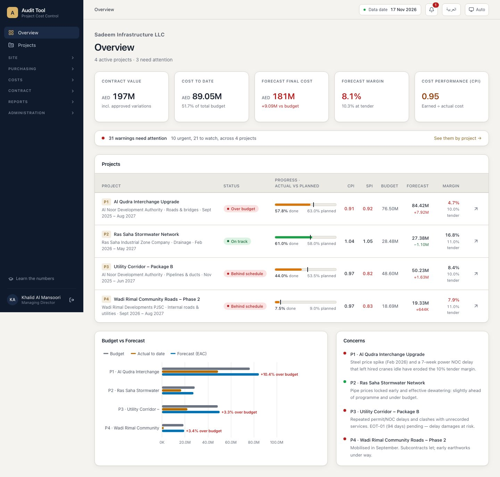
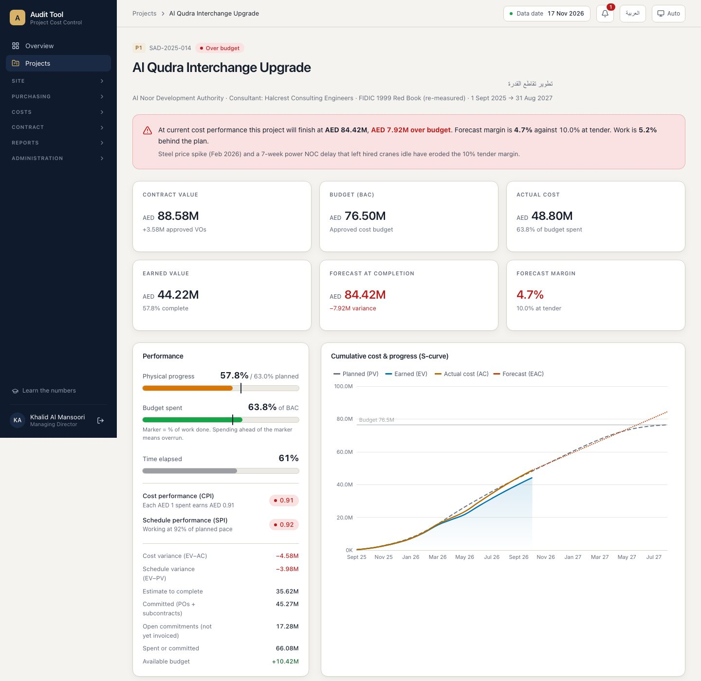
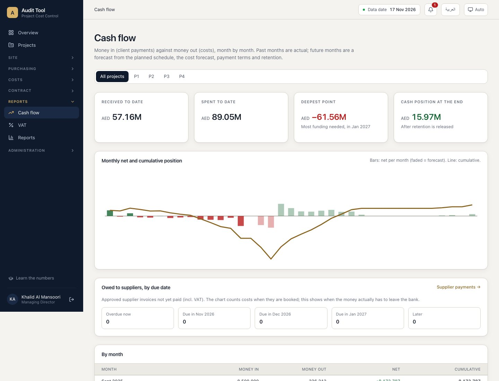
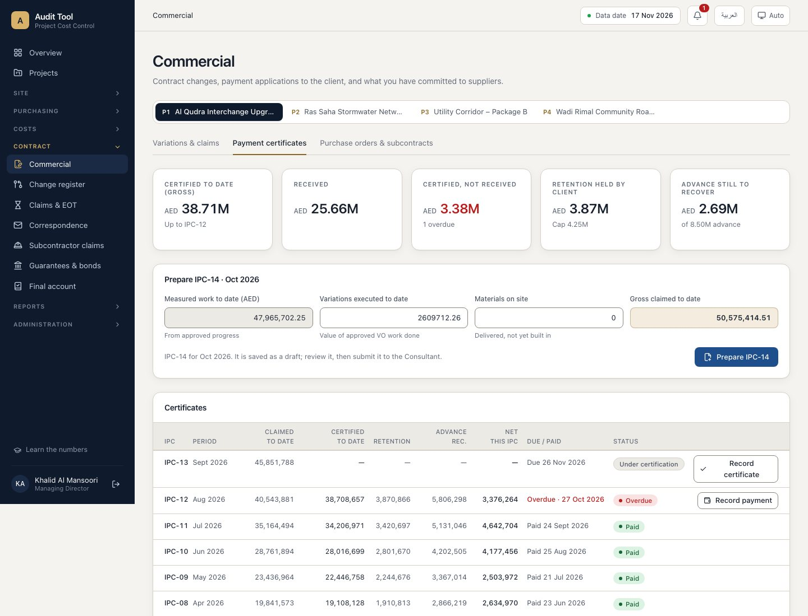
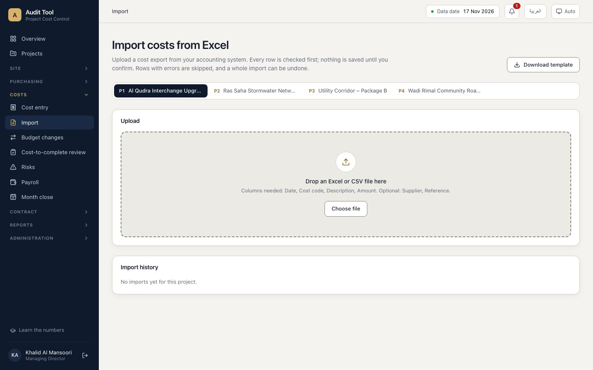
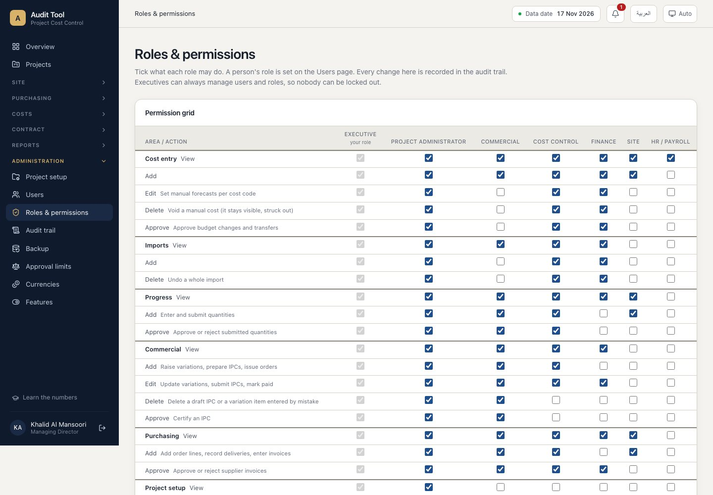
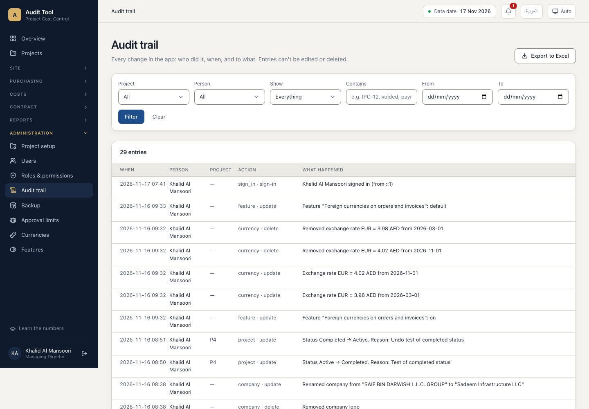
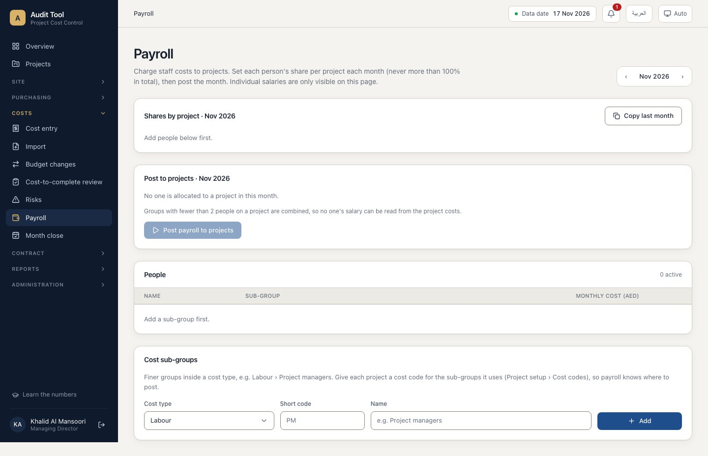

# Audit Tool

Project cost control and earned value management (EVM) for infrastructure contractors in the UAE. It shows where every project stands on budget, schedule, cash and margin.

> **Status:** Complete, working web app I built as a side project for construction contractors. Every company, person and figure shown is fictional seed data. The source code is private; I am happy to walk through it in an interview.

**[View the project page](https://siddik238.github.io/audit-tool-showcase/)**

## At a glance

| | |
|---|---|
| **25,000+** | lines of TypeScript |
| **180+** | automated unit tests |
| **13** | business modules with enforced boundaries |
| **4** | fictional projects, AED 197M portfolio |

## The problem

On a construction contract, the margin can disappear months before anyone notices. Costs sit in the accounting system, progress in site reports, variations and payment certificates in the commercial team's spreadsheets. By the time they are put together at month end, it is too late to act.

Audit Tool brings costs, progress, commercial and cash data together per project and keeps earned value (CPI, SPI, forecast final cost and margin) up to date, so management sees which projects need attention and why.

## What it does

- **Portfolio and project dashboards**: Contract value, cost to date, forecast final cost, margin and CPI/SPI per project. Also an S-curve, cost by type, the largest forecast overruns and a work breakdown.
- **Costs and imports**: Manual cost entry and Excel/CSV imports from the accounting system, with every row checked before saving and whole imports that can be undone.
- **Commercial control**: Variations and claims, extension-of-time claims, interim payment certificates (IPCs) with retention and advance recovery, subcontractor claims, guarantees and the final account.
- **Purchasing and materials**: Quotation comparison, purchase orders, a three-way match of order, delivery and invoice, and material checks against the bill of quantities.
- **Cash flow and reports**: Monthly money in against money out with a forecast, VAT, month close with snapshots, and reports.
- **Site and schedule**: Site diary with safety statistics (LTIFR), permits with expiry alerts, documents and RFIs, and a Primavera P6 (.xer) schedule reader.
- **Payroll with privacy**: Staff costs shared across projects under a 100% rule, with individual salaries hidden from project users.
- **Administration**: Roles and permissions grid, approval limits, currencies, feature switches, backup and a full audit trail of who changed what.

## How it is built

- **Modular monolith**: One app and one database split into modules with a single front door each. Lint rules and an architecture test block any import that crosses a boundary before deploy.
- **Tested business rules**: The EVM, payment certificate, payroll and cash-flow maths are pure functions covered by 180+ Vitest tests. CI runs a typecheck, tests, lint, a dependency vulnerability audit and a production build on every push.
- **Security and governance**: Personal accounts only, two-step sign-in (TOTP) for administrators and approvers, and automatic deactivation on a leaver's last day. Also a network allowlist, approval limits, and an append-only audit trail exportable to Excel.
- **Ready to deploy two ways**: On Vercel with Neon Postgres, or on the company's own Linux server with nginx, systemd timers, encrypted nightly backups with a restore test, and written security, incident-response and on-premise guides.

## Tech stack

`Next.js 16` · `React 19` · `TypeScript` · `Drizzle ORM` · `PostgreSQL` · `PGlite` · `Tailwind CSS 4` · `ECharts` · `ExcelJS` · `Vitest` · `GitHub Actions` · `Vercel` · `nginx` · `systemd`

## Screenshots

_All data is fictional._

**Project dashboard: earned value, S-curve and cost by type**

**Cash flow: money in against money out, with funding need and forecast**

**Interim payment certificates with retention and advance recovery**

**Importing costs from Excel, with every row checked**

**Roles & permissions grid**

**Audit trail: every change, who made it and when**

**Payroll charged to projects, with salaries kept private**

## My role

I designed and built the whole app on my own as a side project: I defined the business rules for earned value, payment certificates and cash flow, built the modular architecture and database schema with migrations, and wrote the test suite and CI pipeline. I also seeded a realistic fictional portfolio to test against, and wrote the deployment, security and user guides.

## Contact

Siddik Boyalakuntla · [LinkedIn](https://www.linkedin.com/in/siddikboyalakuntla) · [GitHub](https://github.com/Siddik238) · siddiek.b@gmail.com
